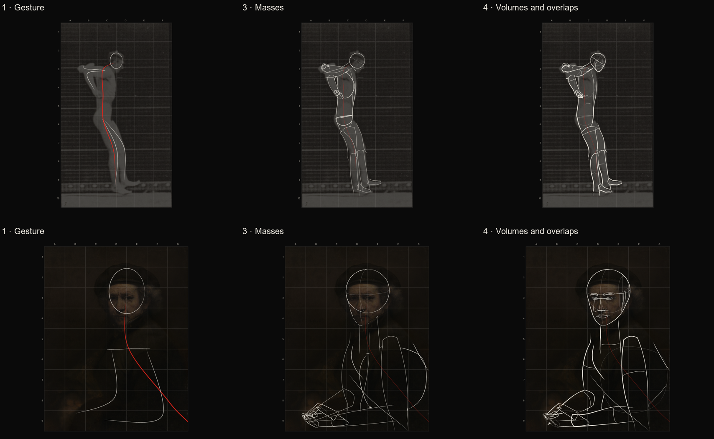

# Masu 升

**A local study companion for painters and draftspeople.** Drop in a reference image and Masu turns it into a step-by-step plan the way a drawing teacher would: gesture, construction, block-in, values, color, light, composition, perspective and painting order, on top of a grid you can transfer to your canvas.

*Leer en español: [README.es.md](README.es.md)*



- **Runs entirely on your computer.** Your images never leave it, and once installed it works offline.
- **It does not draw for you.** No image generation: Masu reads the reference and shows you how to build it, so *you* draw it.
- **It says when it doesn't know.** If a reading is weak (flat light, hidden limbs, no vanishing lines) Masu tells you instead of inventing.
- **English and Spanish**, picked from your browser. More languages are welcome: see [Translating](#translating).

## What it does

| Key | Mode | What for |
| --- | --- | --- |
| 1 | Reading | Summary of the image and recommendations; each finding links to its tool |
| 2 | Canvas | Canvas size (presets or custom) and framing |
| 3 | Grid | Grid in cm or inches, by count or as diamonds, and a close reading of each cell |
| 4 | Values | Value zones, 3 to 11 step scales, notan, squint, histogram |
| 5 | Color | Temperature, saturation, hard and soft edges, harmony, eyedropper and mixing recipes for your own tubes |
| 6 | Subjects | Real, anime and animal faces, covered heads, hands, feet and objects; face guides and the Loomis ball |
| 7 | Composition | Identifies the scheme among ten (thirds, golden ratio, spiral, diagonal, triangle, centered, symmetry, curve, converging lines, horizon), draws it and suggests a crop |
| P | Perspective | Vanishing points, horizon, lens type, curved perspective (fisheye), vanishing points judged by depth; drag or add points by hand |
| L | Light | Where each light comes from with its rays, terminator, form and cast shadows, accents, highlights and rim light; "try another light" by dragging the sun |
| 8 | Construction | Ten cumulative steps from gesture to finished drawing (below) |
| 9 | Figures | Separates characters; tap anything to cut it out |
| 0 | Block-in | Straight-line envelope, blocks per part in order, angular contour and interior |
| - | Simplify | Flat shapes, planes, ink, paint by numbers |
| = | Paint | Progress, order and difficulty of each cell, technique, paint needed, compare with your painting |

### Construction, like a figure-drawing class

1. **Gesture**: line of action and the rhythms of arms and legs, shoulder and hip tilt.
2. **Skeleton**: proportions measured in heads.
3. **Masses**: rib cage as an egg, pelvis as a bowl, joined by a torso that pinches on one side and stretches on the other.
4. **Volumes and overlaps**: every part takes the width it really has in *this* figure, read from a 3D body mesh; what is in front overlaps what is behind, and cross-contours show where the form turns.
5. **Forms**, 6. **Planes**, 7. **Block-in**, 8. **Contour**, 9. **Two values (notan)**, 10. **Final drawing**.

Lines have three weights, like a pencil drawing: faint construction, firm form lines, a weighted contour. Steps 1 to 4 change with the **style** (realistic, anime, cartoon, caricature, concept, painting with the light read from the image), plus exaggeration and simplification sliders. Hands are built from their 21 points (box palm, wedge thumb, tube fingers, knuckle arc). Heads can be built with Loomis, anime, Reilly, Asaro, skull, muscles or measured proportions. There is also a **quick pose** timer (30 s to 10 min) and a **clothing folds** reader.

## Install

You need [Node.js](https://nodejs.org) 20 or newer and about 1.5 GB of disk.

```bash
git clone https://github.com/alejndrougl/masu.git
cd masu
npm install
npm run setup     # downloads the models (~1 GB) once
npm run build
npm start         # open the address it prints
```

On Windows you can double-click **`Abrir Masu.bat`**: the first time it installs everything.

A computer without a dedicated GPU works; the first analysis of an image takes 40 to 90 seconds.

## How reliable is it

Masu measures; it does not guess. Still:

- Mixing recipes use an approximate pigment model. Test them on your palette first.
- Perspective needs straight lines or a readable background. Drag the points to correct them.
- Masu only draws what has evidence: a joint outside the figure does not count, so a strongly foreshortened leg may be missing. When the 3D body reading fails, fix it with **Move joints**.
- Light is read from how brightness changes over the form. It is solid on photos and renders with clear shadows, weak on patterned clothes or flat light, and Masu says how sure it is. A flat-color drawing has no shadow to read, and Masu says so.

## Models and licenses

Masu's code is under the [MIT license](LICENSE). The models that `npm run setup` downloads are **not** part of this repository and keep their own terms:

| Use | Model | License |
| --- | --- | --- |
| 3D body | InstantHMR medium | CC BY-NC 4.0 (non-commercial). For commercial use switch to `instanthmr-medium-commercial.onnx` (Apache-2.0) |
| Body mesh | MHR body | Apache-2.0 |
| Pose, hands, feet and face in any style | DWPose | Apache-2.0 |
| Face landmarks, hands, objects | MediaPipe (FaceLandmarker, HandLandmarker, EfficientDet) | Apache-2.0 |
| Real, anime and animal faces; anime people, hands and eyes | deepghs detection models | see each model card |
| Hands in drawings | RTMPose Hand | Apache-2.0 |
| Animals | ViTPose++ APT-36K | Apache-2.0 |
| Body parts | SegFormer B2 clothes | see model card |
| Face parts | face-parsing (CelebAMask-HQ) | research and education only |
| Cut-outs | SlimSAM, IS-Net anime | Apache-2.0 |
| Depth | Depth Anything v2 small | Apache-2.0 |
| Line art | Informative Drawings | see model card |

Anime facial landmarks (CFA) are optional and never downloaded: the original repository declares no license.

## Contributing

Masu is a community project. Artists and teachers are as welcome as programmers: the most valuable contribution is often **"this is not how a draftsman would build it"** with a picture. See [CONTRIBUTING.md](CONTRIBUTING.md).

- Report a bad reading: open an issue with the image (only images you are allowed to share) and what a teacher would do instead.
- Good first issues are labeled [`good first issue`](../../labels/good%20first%20issue).
- Questions and ideas go to [Discussions](../../discussions).

### Translating

All text lives in `src/i18n/`. To add a language, copy `en.ts`, translate it, and register it in `src/i18n/index.ts`. TypeScript will tell you if a key is missing. Details in [CONTRIBUTING.md](CONTRIBUTING.md#translations).

## Development

```bash
npm run dev       # development server
npm test          # unit tests (geometry, light, construction, subjects)
npm run build     # type-check and build to dist/
```

Browser checks with real models live in `dev/` (Playwright): for example `node dev/smoke.mjs <image> [port]` walks every mode of the built app served by `npm start`, and `node dev/matriz.mjs <out> <port> 1,3,4 realista,anime,cartoon <images...>` renders the construction steps in several styles.

Sources consulted for the drawing and painting rules are listed in [FUENTES.md](FUENTES.md).
